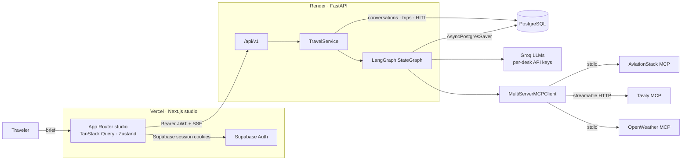
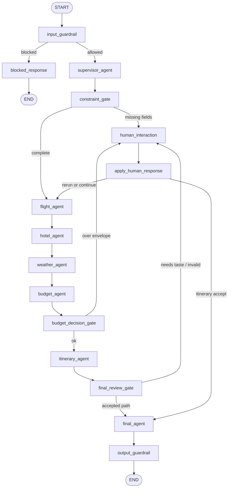

<p align="center">
  
</p>

<h1 align="center">VoyageMesh</h1>

<p align="center">
  <strong>A multi-agent travel workspace that researches, estimates, and pauses — then leaves the last word with you.</strong>
</p>

<p align="center">
  <a href="https://voyagemesh.vercel.app/"></a>
  <a href="https://github.com/RAHULDINDIGALA-32/voyagemesh"></a>
  <a href="LICENSE"></a>
  
  
  
</p>

<p align="center">
  <a href="https://voyagemesh.vercel.app/">Live app</a>
  ·
  <a href="#system-architecture">Architecture</a>
  ·
  <a href="#getting-started">Getting started</a>
  ·
  <a href="CONTRIBUTING.md">Contributing</a>
  ·
  <a href="SECURITY.md">Security</a>
</p>

---

VoyageMesh turns a rough trip brief into a **voyage document**: flights, stays, weather, budget, day plan, packing list, and timeline. A supervisor routes work across specialist desks. Deterministic gates stop the graph when a constraint is missing, a budget overruns, or an itinerary needs taste. Nothing is booked. Nothing is invented in the gaps.

| | |
| --- | --- |
| **Product** | [https://voyagemesh.vercel.app/](https://voyagemesh.vercel.app/) |
| **Source** | [https://github.com/RAHULDINDIGALA-32/voyagemesh](https://github.com/RAHULDINDIGALA-32/voyagemesh) |
| **Frontend** | Next.js 16, React 19, TypeScript, Tailwind CSS 4, Zustand, TanStack Query |
| **Backend** | FastAPI, LangGraph, LangChain, Groq, MCP, PostgreSQL |
| **Auth** | Supabase Auth (JWT verified on the API) |
| **Deploy** | Vercel (studio) · Render (API, Docker) |

---

## Table of contents

- [Why VoyageMesh](#why-voyagemesh)
- [Product surface](#product-surface)
- [System architecture](#system-architecture)
- [Agent mesh](#agent-mesh)
- [Human-in-the-loop](#human-in-the-loop)
- [Guardrails](#guardrails)
- [Model Context Protocol](#model-context-protocol)
- [Data model](#data-model)
- [HTTP API](#http-api)
- [Repository layout](#repository-layout)
- [Tech stack](#tech-stack)
- [Getting started](#getting-started)
- [Configuration](#configuration)
- [Testing](#testing)
- [Deployment](#deployment)
- [Observability](#observability)
- [Security](#security)
- [Limitations](#limitations)
- [Contributing](#contributing)
- [License](#license)

---

## Why VoyageMesh

Most travel chatbots collapse research, judgment, and booking language into one free-form reply. VoyageMesh separates those jobs:

1. **Specialists research a lane.** Flights, hotels, and weather talk to tools through MCP. Budget and itinerary consume structured cards, not raw tool dumps.
2. **The server owns control flow.** The supervisor may *select* desks. Permitted node names, dependency order, interrupts, and retries live in the compiled LangGraph — not in the model.
3. **Humans decide at the seams.** Missing origin/dates, an over-envelope estimate, or a day plan that needs taste become typed HITL cards with allowed actions, versioning, and TTL.
4. **Outputs stay honest.** Input and output guardrails block prompt injection, unsafe requests, secret leakage, and unsupported booking claims. Tool results are treated as untrusted reference data.

---

## Product surface

| Surface | Route | Role |
| --- | --- | --- |
| Marketing landing | `/` | Explains the mesh, desks, and review pauses |
| Auth | `/login`, `/signup`, `/verify-email` | Supabase email auth |
| Studio home | `/app` | New brief + conversation list |
| Conversation | `/app/c/[conversationId]` | Streaming chat, HITL cards, voyage folio |
| Trips | `/app/trips`, `/app/trips/[tripId]` | Saved voyage documents |
| Desk | `/app/settings` | Account, theme, sign-out |

The studio streams graph progress over **Server-Sent Events**, renders specialist cards in a voyage folio, and exports a print-ready **PDF booklet** (`@react-pdf/renderer`). Conversations and trips can be renamed or soft-deleted. Light, dark, and system themes are supported.

---

## System architecture



**Request path**

1. The studio refreshes the Supabase session in middleware and sends the user access token to FastAPI.
2. FastAPI verifies HS256 (JWT secret) or JWKS-signed tokens, then scopes every thread to `user_id`.
3. `TravelService` creates an owned conversation/trip pair, compiles the graph against a Postgres checkpointer, and streams node updates.
4. Specialist agents write typed cards into `TravelState`. Gates may `interrupt()` for HITL. The final agent assembles the voyage document.
5. Product tables store the latest payload; LangGraph checkpoints store durable graph state so a pause can resume hours later.

---

## Agent mesh

The compiled graph is the source of truth for execution. Models propose; the workflow dispatches.



| Desk | Responsibility | Tools / model |
| --- | --- | --- |
| **Supervisor** | Extract constraints, select specialists, never invent missing fields | Groq (`GROQ_SUPERVISOR_API_KEY`) |
| **Flights** | Current route schedules via IATA codes; no fares, no future tickets | AviationStack MCP |
| **Stay** | At most three stays grounded in search URLs; no implied availability | Tavily MCP |
| **Weather** | Current + forecast overview for packing and day pacing | OpenWeather MCP |
| **Budget** | Transparent estimate from flight/hotel cards vs envelope | Groq (`GROQ_BUDGET_API_KEY`) |
| **Itinerary** | Chunked day plans with salvage/retry; open days if a chunk fails | Groq (`GROQ_ITINERARY_API_KEY`) |
| **Chart (final)** | Chat wrap, packing list, timeline, assembled `trip_document` | Groq (`GROQ_FINAL_API_KEY`) |

MCP research agents share a primary Groq key and a rate-limit **alternate** key. The runner stops on a structured `json` tool call, clips tool payloads, and falls back to an honest empty card instead of fabricating research.

The supervisor may choose a subset of desks. `select_next_agent` walks a **server-owned order** (`flight → hotel → weather → budget → itinerary → final`). The model cannot jump to an arbitrary node.

---

## Human-in-the-loop

LangGraph `interrupt()` freezes the thread. The API validates the resume payload before `Command(resume=...)`.

| Intervention | When | Allowed actions |
| --- | --- | --- |
| `constraint_clarification` | Selected work lacks origin, destination, dates, travelers, or budget | `submit` |
| `budget_decision` | Estimate exceeds the stated envelope | `reduce_cost`, `increase_budget`, `continue` |
| `itinerary_review` | A usable day plan is ready, or the traveler wants a change | `accept`, `modify`, `regenerate` |

Operational guarantees:

- **Contracts** — Pydantic `HumanResponseRequest` with field limits, allowed-action sets, and 24h TTL.
- **Versioning** — `expected_version` rejects stale cards (`StaleIntervention`).
- **Idempotency** — `hitl_interventions` claims a pending row atomically so two tabs cannot double-resume.
- **Recovery** — resume reaper, retry, cancel, and reopen endpoints for crashed or abandoned pauses.
- **Ownership** — thread access is checked against the signed-in `user_id` (`NotOwner` / `WorkflowNotFound`).

---

## Guardrails

| Layer | What it blocks |
| --- | --- |
| Deterministic **input** | Empty/overlong queries, control characters, prompt-injection phrasing, unsafe document/border requests |
| Model **input** | Off-domain or policy-violating briefs (cannot override the deterministic fail) |
| Deterministic **output** | Secret-shaped strings, system-prompt leakage, “you’re booked” language |
| Model **output** | Unsupported claims against the supplied research cards |
| Tool isolation | Search snippets are untrusted; MCP child processes receive only the secrets they need |
| Routing | Specialist order and HITL node names are not model-controlled |

Blocked requests short-circuit to `blocked_response` without tools or downstream agents.

---

## Model Context Protocol

`MultiServerMCPClient` loads tools per server so one provider outage does not take down the others.

| Server | Transport | Tooling |
| --- | --- | --- |
| `aviationstack` | stdio (`aviationstack_server.py`) | `search_route_flights(origin_iata, destination_iata)` — live schedules, not dated fares |
| `tavily` | streamable HTTP | Web search for stays (result count and page content enforced in the runner) |
| `weather` | stdio (`weather_server.py`) | `get_weather_overview` / current + 5-day forecast via OpenWeather |

---

## Data model

PostgreSQL is both the **LangGraph checkpointer** and the product store.

```
voyagemesh_conversations     1 ─── N  voyagemesh_messages
            │
            1
            │
            └── 1  voyagemesh_trips   (latest_payload JSONB = voyage document)

hitl_interventions            keyed by intervention_id + thread_id
langgraph checkpoint tables   AsyncPostgresSaver.setup()
```

| Table | Purpose |
| --- | --- |
| `voyagemesh_conversations` | Thread ownership, title, status, soft delete |
| `voyagemesh_messages` | User / assistant / system turns for the studio transcript |
| `voyagemesh_trips` | Cover metadata + `latest_payload` (structured folio) |
| `hitl_interventions` | Pending / resuming / resolved audit with claim semantics |

Statuses map from graph execution (`running`, `awaiting_human`, `completed`, `blocked`, …) to product labels (`draft`, `awaiting_you`, `ready`, …).

---

## HTTP API

Base path: `/api/v1`. All trip and conversation routes require `Authorization: Bearer <supabase access token>`.

| Method | Path | Description |
| --- | --- | --- |
| `GET` | `/health` | Liveness |
| `GET` | `/conversations` | List owned conversations |
| `GET` | `/conversations/{id}` | Conversation + messages |
| `PATCH` | `/conversations/{id}` | Rename |
| `DELETE` | `/conversations/{id}` | Soft-delete conversation and trip |
| `GET` | `/trips` | List voyage documents |
| `POST` | `/trips` | Create trip (non-streaming) |
| `POST` | `/trips/stream` | Create trip (SSE) |
| `POST` | `/trips/{thread_id}/messages` | Follow-up turn (SSE) |
| `GET` | `/trips/{thread_id}` | Latest trip payload |
| `GET` | `/trips/{thread_id}/status` | Execution + HITL status |
| `GET` | `/trips/{thread_id}/state` | Graph snapshot (debug / studio sync) |
| `POST` | `/trips/{thread_id}/interventions` | Submit HITL response |
| `POST` | `/trips/{thread_id}/interventions/reopen` | Re-open an expired/failed pause |
| `POST` | `/trips/{thread_id}/retry` | Retry a failed resume |
| `POST` | `/trips/{thread_id}/cancel` | Abort the workflow |

OpenAPI (`/docs`, `/redoc`) is enabled only when `ENVIRONMENT` is not `production`.

---

## Repository layout

```
voyagemesh/
├── frontend/                 Next.js App Router studio + landing
│   ├── app/                  (marketing) (auth) (studio) routes
│   ├── components/           chat, trips, marketing, HITL cards
│   ├── lib/                  API client, SSE, Supabase, PDF export
│   └── public/vm-logo.png    Compass mark
├── backend/                  FastAPI + LangGraph
│   ├── agents/               supervisor, specialists, structured cards
│   ├── graph/                state, nodes, compiled workflow
│   ├── guardrails/           input / output policy
│   ├── hitl/                 contracts, constraints, errors
│   ├── mcp_integrations/     MCP client, servers, agent runner
│   ├── infrastructure/       Postgres pool, product + HITL repos
│   ├── api/                  auth, routes, schemas
│   ├── services/             TravelService (stream, resume, ownership)
│   └── tests/                workflow, guardrail, and runner tests
├── render.yaml               Render web service (Docker)
├── CONTRIBUTING.md
├── SECURITY.md
└── LICENSE                   MIT
```

---

## Tech stack

**Studio**

- Next.js 16 (App Router) · React 19 · TypeScript
- Tailwind CSS 4 · GSAP (landing motion)
- Supabase SSR (`@supabase/ssr`) · TanStack Query · Zustand
- `@react-pdf/renderer` for the voyage booklet

**API**

- Python 3.11+ (Docker image: Python 3.13) · FastAPI · Uvicorn · uv
- LangGraph + `langgraph-checkpoint-postgres`
- LangChain · `langchain-groq` · `langchain-mcp-adapters`
- Pydantic Settings · PyJWT · SQLAlchemy / psycopg 3 pool

**Platform**

- PostgreSQL (product data + checkpoints + HITL)
- Groq (`openai/gpt-oss-120b` by default)
- Tavily · AviationStack · OpenWeather
- Optional LangSmith tracing
- Vercel · Render (health check `/api/v1/health`)

---

## Getting started

### Prerequisites

- Node.js 20+
- Python 3.11+ and [uv](https://docs.astral.sh/uv/)
- PostgreSQL 16+ (or a hosted instance)
- A [Supabase](https://supabase.com/) project
- API keys: Groq (per desk), Tavily, AviationStack, OpenWeather

### 1. Database

Create a database and keep the **external** Postgres URL. The API runs `AsyncPostgresSaver.setup()` plus product/HITL `CREATE TABLE IF NOT EXISTS` on boot — no separate migration CLI.

### 2. Backend

```bash
cd backend
cp .env.example .env
# fill in keys — see Configuration
uv sync
uv run uvicorn main:app --reload --port 8000
```

Health check: [http://localhost:8000/api/v1/health](http://localhost:8000/api/v1/health)

### 3. Frontend

```bash
cd frontend
cp .env.example .env.local
npm install
npm run dev
```

Studio: [http://localhost:3000](http://localhost:3000)

Point `NEXT_PUBLIC_API_URL` at the API and configure Supabase URL + anon key. In the Supabase dashboard, add `http://localhost:3000/auth/callback` to redirect URLs.

### 4. Smoke path

1. Sign up and verify email.
2. Open `/app` and send a brief (`HYD → NRT, 12–21 Mar, 3 travelers, moderate pace`).
3. Confirm constraint / budget / itinerary cards when the mesh pauses.
4. Open the assembled folio and export PDF.

---

## Configuration

### Frontend (`frontend/.env.local`)

| Variable | Purpose |
| --- | --- |
| `NEXT_PUBLIC_SUPABASE_URL` | Supabase project URL |
| `NEXT_PUBLIC_SUPABASE_ANON_KEY` | Publishable/anon key only — never a service-role key |
| `NEXT_PUBLIC_API_URL` | API origin, e.g. `http://localhost:8000` |

### Backend (`backend/.env`)

| Variable | Purpose |
| --- | --- |
| `GROQ_SUPERVISOR_API_KEY` | Supervisor desk (required; no silent fallback) |
| `GROQ_BUDGET_API_KEY` | Budget desk |
| `GROQ_ITINERARY_API_KEY` | Itinerary desk |
| `GROQ_FINAL_API_KEY` | Final chart desk |
| `GROQ_MCP_API_KEY` | Flight / hotel / weather runner |
| `GROQ_ALT_MCP_API_KEY` | MCP runner fallback on Groq 429 |
| `TAVILY_API_KEY` | Stay research |
| `AVIATIONSTACK_API_KEY` | Route schedules |
| `OPENWEATHER_API_KEY` | Weather MCP |
| `DATABASE_URL` | Postgres DSN (`sslmode=require` is added for non-local hosts) |
| `FRONTEND_URL` | CORS allowlist (plus `http://localhost:3000`) |
| `SUPABASE_URL` | JWKS verification for non-HS256 tokens |
| `SUPABASE_JWT_SECRET` | HS256 user JWT secret from Supabase API settings — not the service-role key |
| `ENVIRONMENT` | `development` or `production` |
| `LLM_MODEL` | Default `openai/gpt-oss-120b` |
| `LANGSMITH_TRACING` / `LANGSMITH_API_KEY` / `LANGSMITH_PROJECT` | Optional tracing |

Dedicated Groq keys exist for **rate-limit isolation**. The process will not substitute `GROQ_API_KEY` for a missing desk key.

---

## Testing

```bash
cd backend
uv run python -m unittest discover -s tests -v
```

Coverage includes supervisor plan parsing, input/output guardrails, HITL contracts, graph routing (`select_next_agent`), and TravelService resume behavior with a memory checkpointer.

```bash
cd frontend
npm run lint
npm run build
```

---

## Deployment

| Piece | Host | Notes |
| --- | --- | --- |
| Studio | [Vercel](https://vercel.com/) | Root: `frontend`. Set `NEXT_PUBLIC_*` for the production API and Supabase project. |
| API | [Render](https://render.com/) | `render.yaml` builds `backend/Dockerfile` (uv, non-root `appuser`, single Uvicorn worker). Health: `/api/v1/health`. |
| Database | Managed Postgres | Use the external URL; the image expects `PORT` (Render injects it). |

Production CORS is the configured `FRONTEND_URL`. Docs and OpenAPI are disabled when `ENVIRONMENT=production`.

---

## Observability

- Structured logging around specialist failures, stream errors, and HITL resume.
- Optional **LangSmith** project `VoyageMesh` (`LANGSMITH_TRACING`).
- Render health checks against `/api/v1/health`.
- SSE `error` events surface recoverable failures to the studio without dropping the thread record.

---

## Security

See [SECURITY.md](SECURITY.md) for how to report issues.

In-product controls:

- Supabase user JWTs; API never uses a service-role key to impersonate travelers
- Per-user thread ownership on every mutation
- HITL claim/version/TTL to prevent replay of old review cards
- Guardrails against injection, secret echo, and fake bookings
- MCP subprocess environment limited to the provider secret that server needs
- Docker runtime as a non-root user

---

## Limitations

VoyageMesh is a **research and planning** workspace:

- Flight tools return **current** operating schedules, not tickets for future dates, and **no fares**.
- Hotel options are search-grounded suggestions, not live inventory.
- Budgets are estimates from those cards, not payment or reservation state.
- Weather is a forecast snapshot, not a guarantee for travel dates.
- The mesh will pause or say “unavailable” rather than invent a booking.

---

## Contributing

Contributions are welcome. Please read **[CONTRIBUTING.md](CONTRIBUTING.md)** for the development workflow, branch conventions, and review expectations.

## License

[MIT](LICENSE) © 2026 RAHUL DINDIGALA
